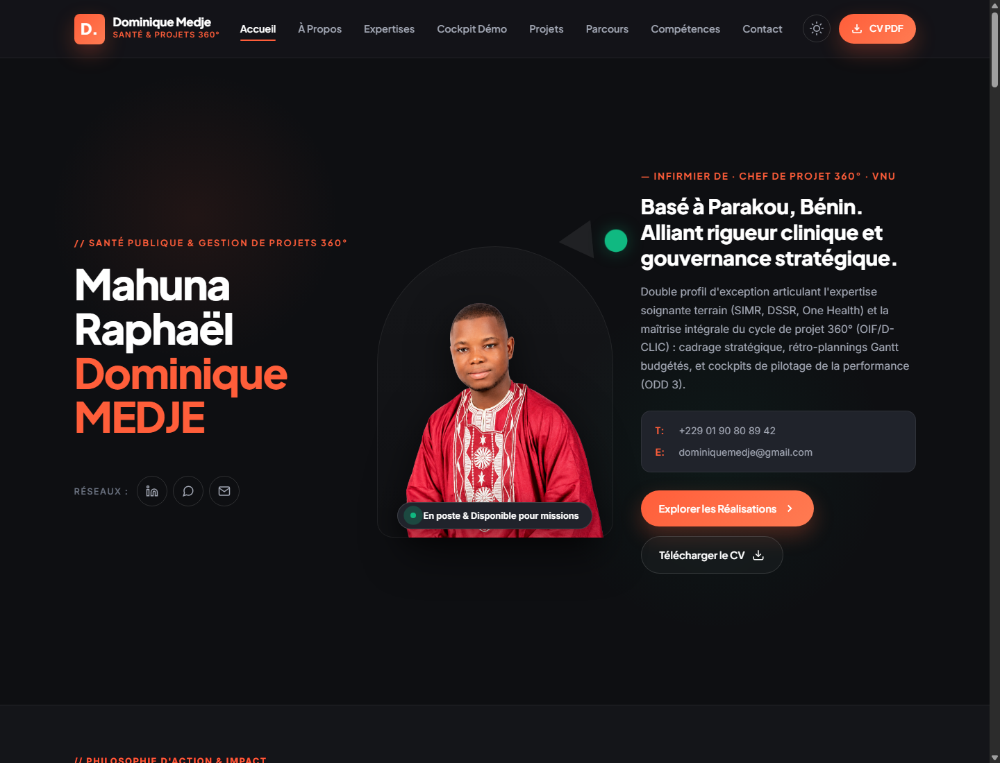

# Portfolio Officiel — Mahuna Raphaël Dominique MEDJE
> **Santé Publique & Gestion de Projets 360° | Infirmier Diplômé d'État (IDE/IAS) | Volontaire des Nations Unies (VNU)**



[](https://vercel.com/new/clone?repository-url=https%3A%2F%2Fgithub.com%2Fogoulajesse%2Fportfolio-dominique-medje)
[](https://linkedin.com/in/dominiquemedje)
[](assets/docs/CV_Dominique_MEDJE.pdf)
[](https://www.un.org/sustainabledevelopment/fr/health/)
[](#contact)

---

## 🎯 À Propos

Portfolio web dynamique haut de gamme de **Mahuna Raphaël Dominique MEDJE**, alliant pratique clinique rigoureuse, leadership communautaire et pilotage stratégique de projets médico-sociaux à fort impact (ODD 3).

### Double ADN Stratégique
- **Pratique Clinique & Santé Communautaire :** Infirmier Diplômé d'État (IFSIO - Université de Parakou), Agent de Santé Communautaire Qualifié (ASCQ) au Ministère de la Santé du Bénin, Point Focal Santé Sexuelle & Reproductive (DSSR) pour Médecins du Monde Suisse & Programme VNU.
- **Pilotage de Projets 360° :** Spécialiste certifié OIF / Programme D-CLIC : diagnostic stratégique, rétro-planning Gantt jalonné, modélisation budgétaire prévisionnelle, cockpits de pilotage décisionnel (KPIs & ROI social), et communication omnicanale.

---

## 🚀 Fonctionnalités Clés du Portfolio

1. **Design Éditorial Sombre & Switcher Mode Clair :**
   - Palette haut de gamme graphite mat (`#0e0f12`), monogramme d'action corail (`#ff5e3a`) et accents émeraude (`#10b981`).
   - Bascule fluide entre thèmes clair et sombre avec sauvegarde locale (`localStorage`).

2. **Compteurs d'Impact Animés :**
   - `+4` Années d'action clinique & terrain.
   - `+15 000` Bénéficiaires et citoyens sensibilisés (VAD, DSSR, PEV).
   - `100%` Rigueur méthodologique (Gantt, budgets prévisionnels, cockpits KPI).
   - `ODD 3` Santé et bien-être universels.

3. **Cockpit Démo de Pilotage 360° (Interactif) :**
   - 📊 **Tableau de bord KPI :** Pilotage en temps réel de 4 indicateurs critiques.
   - 📅 **Rétro-Planning Gantt :** Découpage jalonné par phase (Diagnostic, Cadrage, Déploiement, Évaluation).
   - 💰 **Simulateur Budgétaire :** Curseur interactif permettant d'ajuster l'enveloppe financière avec ventilation dynamique automatique (Santé 50%, Communication 30%, Pilotage 20%).

4. **Études de Cas & Modale Dynamique :**
   - Filtrage par catégorie (*Gestion de Projets 360°*, *Santé Publique & DSSR*, *Action Communautaire*).
   - Modale immersive de consultation de cas d'étude (contexte, défis, méthodologie et résultats durables).

5. **Parcours & Cursus Chronologique :**
   - Bascule instantanée entre *Expériences Professionnelles* et *Formations & Diplômes*.
   - Showcase des certifications d'excellence : **Campus AFD**, **DisasterReady**, **ONU Femmes**, **IDEP / CEA**, **OPS / OMS**, **OIF / D-CLIC**.

6. **Prise de Contact Directe :**
   - Bouton de lancement instantané **WhatsApp** avec message pré-rempli.
   - Formulaire interactif avec retour d'information visuel (*toast notification*).
   - Téléchargement en un clic du [CV officiel en PDF](assets/docs/CV_Dominique_MEDJE.pdf).

---

## ⚡ Déploiement sur Vercel (Recommandé)

Le projet intègre un fichier `vercel.json` pré-configuré (en-têtes de sécurité HTTP, politiques de cache CDN haute vitesse pour les assets, et URLs propres) ainsi qu'un `package.json` standard.

### Option A — Déploiement en 1 Clic (Le plus simple)
Cliquez sur le bouton ci-dessous pour importer et déployer automatiquement le projet sur votre tableau de bord Vercel :

[](https://vercel.com/new/clone?repository-url=https%3A%2F%2Fgithub.com%2Fogoulajesse%2Fportfolio-dominique-medje)

### Option B — Via le Dashboard Vercel
1. Connectez-vous sur [vercel.com](https://vercel.com).
2. Cliquez sur **Add New... > Project**.
3. Importez le dépôt GitHub `ogoulajesse/portfolio-dominique-medje`.
4. Laissez les réglages par défaut (Framework Preset : *Other / Static*).
5. Cliquez sur **Deploy**. En moins de 15 secondes, votre portfolio est en ligne avec HTTPS et CDN mondial !

### Option C — Via Vercel CLI
```bash
# Dans le dossier portfolio :
vercel
# Pour déployer directement en production :
vercel --prod
```

---

## 🌐 Déploiement sur GitHub Pages (Alternative)

1. Rendez-vous dans les **Settings** de votre dépôt GitHub.
2. Cliquez sur l'onglet **Pages** dans le menu latéral gauche.
3. Sous **Build and deployment > Source**, choisissez **Deploy from a branch**.
4. Sélectionnez la branche `main` et le dossier `/ (root)`, puis cliquez sur **Save**.
5. Votre portfolio sera accessible en ligne à l'adresse :
   `https://ogoulajesse.github.io/portfolio-dominique-medje/`

---

## 💻 Stack Technologique

- **HTML5 sémantique** (Standard W3C, méta-données Open Graph / SEO).
- **CSS3 moderne** (Variables CSS, Grid, Flexbox, Glassmorphism, animations fluides).
- **JavaScript Vanilla ES6+** (Performances maximales, 0 dépendance npm requise, compatibilité universelle).
- **Vercel Edge Ready** (Fichier `vercel.json` avec en-têtes de sécurité nosniff, cache CDN optimisé).

---

## 📂 Structure du Répertoire

```text
portfolio/
├── index.html                      # Page d'accueil interactive du portfolio
├── vercel.json                     # Configuration Vercel (headers, cache CDN, cleanUrls)
├── package.json                    # Métadonnées et scripts de démarrage Vercel
├── CV_Dominique_MEDJE.html         # Version HTML autonome du CV
├── CV_Dominique_MEDJE.pdf          # CV exécutif officiel au format PDF
├── portfolio_preview.png           # Capture de prévisualisation du portfolio
├── generate_cv.py                  # Script Python source de compilation du CV
├── README.md                       # Documentation officielle
├── .gitignore                      # Règles d'exclusion Git & Vercel
├── css/
│   └── style.css                   # Feuilles de styles et design tokens
├── js/
│   └── app.js                      # Logique interactive (cockpit, filtres, modales)
└── assets/
    ├── docs/                       # Documents sources et certificats
    │   ├── CV_Dominique_MEDJE.pdf
    │   ├── CV_original_Dominique_MEDJE.pdf
    │   ├── Profile.pdf
    │   └── Vue_globale_Gestion_de_projets_marketing_360.pdf
    └── images/                     # Médias, portraits HD et captures
        ├── dominique.png           # Portrait détouré (Hero)
        ├── dominique_portrait.jpg  # Photo professionnelle (Section À Propos)
        └── ...
```

---

## 📬 Contact & Coordonnées

- **Téléphone / WhatsApp :** [+229 01 90 80 89 42](https://wa.me/2290190808942)
- **E-mail :** [dominiquemedje@gmail.com](mailto:dominiquemedje@gmail.com)
- **LinkedIn :** [linkedin.com/in/dominiquemedje](https://linkedin.com/in/dominiquemedje)
- **Localisation :** Banikanni, Parakou, République du Bénin

---
*© 2026 Mahuna Raphaël Dominique MEDJE. Tous droits réservés.*
